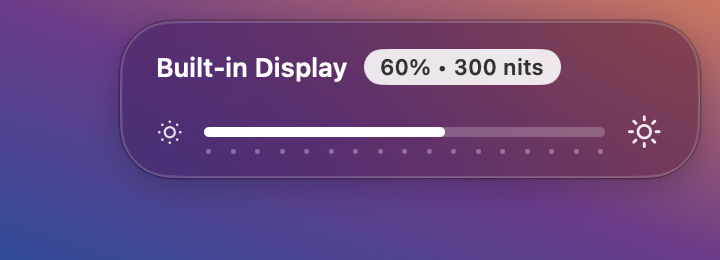
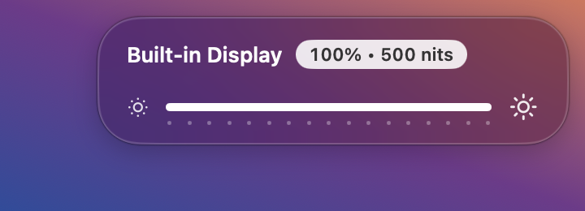
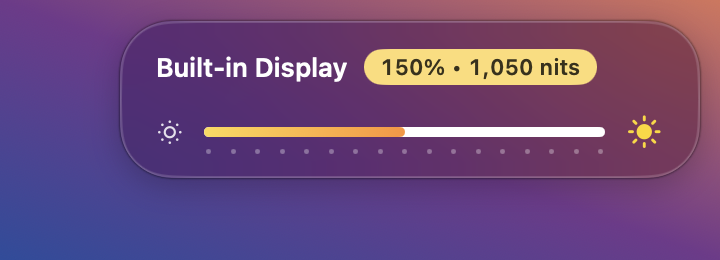
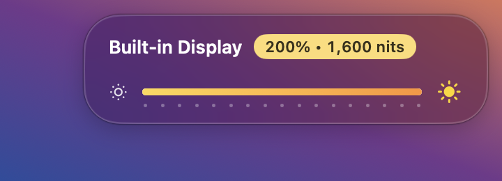

# NitBoost

A small macOS menu-bar app that lets the brightness keys push a Liquid Retina XDR display past its normal SDR limit — up to 1600 nits — with a BetterDisplay-style on-screen indicator.

- **F1 / F2** step brightness 0–100% like macOS (16 steps), then 100–200% in 10% steps. Hold **⌥⇧** for fine steps.
- The HUD shows percent and estimated nits: 100% = 500 nits, 200% = peak (1600 nits by default, configurable to 1000/1200/1400).
- Menu-bar slider (0–200%), peak brightness choice, Launch at Login.
- Automatic updates through Sparkle. Use **Check for Updates…** in the menu, or turn **Automatically Update** on or off.
- When an update needs attention, the menu icon changes to a download arrow. The update menu item shows the available version.
- Unplugging removes the boost immediately. Normal brightness stays under macOS control, up to 100% (500 estimated nits in NitBoost).
- On battery, you can manually raise brightness to 200% with the slider or brightness keys. Battery updates preserve your manual choice.
- Reconnecting power preserves the current brightness. It does not restore an earlier boost automatically.

| 60% | 100% | 150% | 200% |
|---|---|---|---|
|  |  |  |  |

## Install

1. Download **NitBoost-1.0.1.dmg** from the [latest release](https://github.com/dodat1905/nitboost/releases/latest).
2. Open it and drag **NitBoost** into **Applications**.
3. Open NitBoost. The app is not notarized by Apple, so macOS blocks the first launch: open **System Settings → Privacy & Security** and click **Open Anyway**.
   (Or run `xattr -dr com.apple.quarantine /Applications/NitBoost.app` once.)
4. When asked, allow NitBoost in **System Settings → Privacy & Security → Accessibility**. The brightness keys need this.
5. Quit other apps that handle the brightness keys (for example BetterDisplay).

## How it works

1. A 1×1 pixel Metal window draws EDR content, which makes macOS raise the display's EDR headroom (3.2× on a 14"/16" MacBook Pro).
2. A full-screen, click-through Metal overlay with Core Animation's `multiply` compositing filter multiplies every pixel in linear light by the boost factor (`nits / 500`, capped at the current headroom). Hue and saturation are kept; only luminance rises.
3. A `CGEventTap` intercepts the brightness keys; below 100% it sets the system brightness via the private DisplayServices framework.

Approach informed by [BrightIntosh](https://github.com/niklasr22/BrightIntosh).

Notes from testing on macOS 27:
- Scaling the gamma table above 1.0 only washes the picture out; it does not raise peak brightness.
- `NSWindow.sharingType = .none` disables the multiply filter (screen turns white), and the Core Image name `multiplyBlendMode` stops working after a few seconds — use `multiply`.
- Screenshots and recordings include the overlay, so they look overexposed while boosted.

## Requirements

- Apple Silicon MacBook Pro with a Liquid Retina XDR display
- macOS 13 or later
- Accessibility permission (for the brightness keys)
- Quit other apps that handle the brightness keys (e.g. BetterDisplay)

## Build

```sh
./build.sh           # builds build.noindex/NitBoost.app
./build.sh install   # copies to /Applications and launches
```

Run `zsh test.sh` to check manual boost and power transitions with simulated hardware.

`build.sh` signs with a local code-signing identity named `XDRBoost Local Signing` when one exists (so the Accessibility grant survives rebuilds), otherwise ad-hoc. With ad-hoc signing you must re-grant Accessibility after each rebuild.

Diagnostics: `~/Library/Logs/NitBoost.log`.

## Release

The build downloads Sparkle 2.10.1 and checks its SHA-256 digest. It includes Sparkle and its license in the app bundle.

Run `./release.sh` to create the DMG, ZIP, and signed `appcast.xml`. The script reads the version from `Info.plist`.

The private update key stays in macOS Keychain under the account `com.dodat.nitboost`. Only the public key belongs in `Info.plist`.

Upload both archives to the matching GitHub release. Commit `appcast.xml` to `main` after the archives are available.

Sparkle reads the feed from `https://raw.githubusercontent.com/dodat1905/nitboost/main/appcast.xml`. Update archives and the feed require valid EdDSA signatures.

For each new release, increase `CFBundleVersion`. Run `zsh test.sh` and `python3 Tests/verify_updater.py` before you publish the feed.

The update test stops NitBoost, updates a temporary app through a local server, and restores the installed app afterward.

`release.sh` checks archive signatures with the public key. The check also confirms that a changed archive fails verification.
